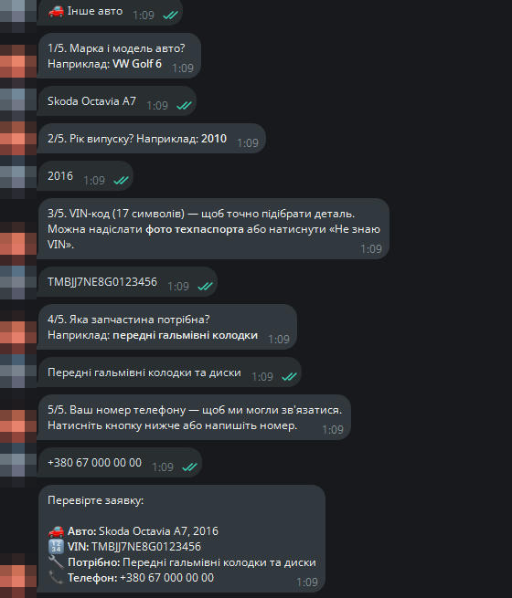
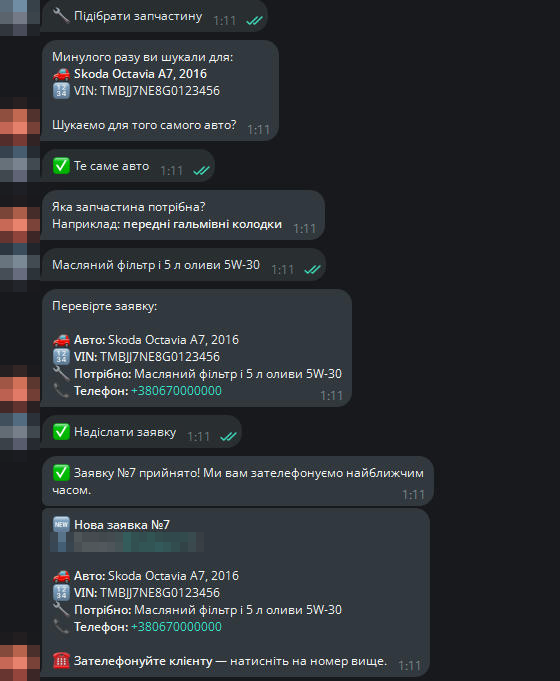
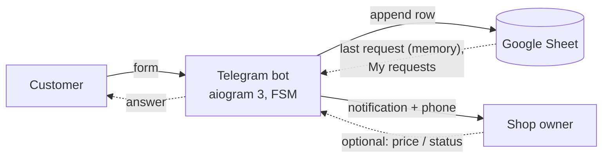

# AvtoHata Bot — Telegram bot for auto parts requests

A Telegram bot for a small auto parts shop in Zhytomyr, Ukraine. Customers describe the part they need in a guided
form, every request lands in a Google Sheet, and the shop owner instantly gets a notification with the customer's
phone number — one tap to call back.

Built for a real shop whose owner is not tech-savvy: the owner's side has **no buttons to learn** — just a message
with a tappable phone number. A fuller "reply from the bot" mode is available behind a single setting.

> Bot UI and the sheet are in Ukrainian (the shop's customers); code comments are in Russian.

| New request (step-by-step form) | Repeat request + owner notification |
|---|---|
|  |  |

<sub>Demo data. In these screenshots one account is both the customer and the shop owner.</sub>

## Features

**For customers**
- Step-by-step request form: car model → year → VIN (or a photo of the registration certificate, or "I don't know")
  → the part → phone number (one-tap "Share contact" button) → confirmation.
- Input validation at every step (VIN format, year range, phone number), cancel at any step.
  Phone numbers are normalized to `+380XXXXXXXXX`, so Telegram makes them tap-to-call.
- **Remembers the previous request**: next time the customer taps "Same car" and only types the part name —
  the car, VIN and phone are filled in from their last request.
- Shop address, phones, map link and opening hours.

**For the shop owner**
- Instant notification for every request (with the VIN photo, if sent); the phone number is tappable → call or copy.
- All requests in a Google Sheet: number, date, customer, phone, car, VIN, part, status, price, delivery time, comment.
- The owner sees no customer menu — only notifications.
- **Handover in one tap**: `/peredat` creates a one-time link (valid 7 days). Whoever opens it becomes
  the owner — no need to look up Telegram IDs or edit config files. The previous owner is notified.

**Optional full mode** (`ADMIN_REPLIES=1`)
- Inline buttons under each notification: ✅ In stock / 📦 On order / ❌ Not available.
- The bot asks for the price (and delivery time with preset buttons), sends the answer to the customer and updates
  the sheet. Double answers are prevented; if the customer blocked the bot, the owner gets their phone instead.
- "📋 My requests" for customers: their last 5 requests with live status read from the sheet —
  if the owner edits a status by hand, the customer sees it.

## How it works



The Google Sheet is the single source of truth — no separate database. The sheet logic (`sheets.py`) knows nothing
about Telegram, so the same storage can be reused for another channel (website form, Viber, etc.).

## Tech stack

- Python 3.15, [aiogram 3](https://docs.aiogram.dev/) (async, FSM, routers, callback data)
- Google Sheets API via [gspread](https://docs.gspread.org/) + service account
- pytest — dialog scenarios tested offline with fake Telegram and fake sheet
- Docker + docker compose

## Project structure

| File | Purpose |
|---|---|
| `bot.py` | Entry point: `/start`, contacts, "My requests", router setup |
| `form.py` | Request form (finite state machine), sheet write, owner notification |
| `admin.py` | Owner replies via inline buttons (full mode) |
| `sheets.py` | Google Sheets: append, find by number, update status, customer history |
| `keyboards.py` | All buttons and callback data |
| `texts.py` | Shop contacts and status labels |
| `config.py` | Settings from `.env` |
| `settings.py` | Runtime settings in `data/settings.json`: current owner, handover link |
| `tests/` | Offline dialog tests |

## Setup

1. **Telegram bot** — create one with [@BotFather](https://t.me/BotFather) and copy the token.
2. **Google Sheet**
   - In Google Cloud Console create a project, enable *Google Sheets API*, create a *service account* and download
     its JSON key as `credentials.json` into the project folder.
   - Create a spreadsheet and share it (Editor) with the service account e-mail from the JSON.
     Headers are created automatically.
3. **Settings** — copy `.env.example` to `.env` and fill in:

   | Variable | Meaning |
   |---|---|
   | `BOT_TOKEN` | token from BotFather |
   | `SHEET_ID` | spreadsheet ID (or full URL) |
   | `ADMIN_ID` | Telegram ID of the initial owner (send `/id` to the bot); later changed via `/peredat` |
   | `ADMIN_REPLIES` | `0` — simple mode (owner calls back), `1` — reply with buttons |
   | `GOOGLE_CREDENTIALS` | path to the service account key, default `credentials.json` |

## Run

**Docker (recommended for a server)**
```bash
docker compose up -d --build
docker compose logs -f
```
Secrets are not baked into the image: `.env` is passed as `env_file`, `credentials.json` is mounted read-only.
The container restarts automatically after a crash or server reboot.

**Locally**
```bash
python -m venv .venv
.venv/bin/pip install -r requirements.txt      # Windows: .venv\Scripts\pip
.venv/bin/python bot.py
```
On Windows `start.bat` does all of this in one click.

> Only one copy of the bot can run at a time (Telegram polling) — stop the local one before starting on a server.

## Tests

```bash
pip install -r requirements-dev.txt
python -m pytest -q
```
Telegram and Google Sheets are replaced with fakes, so the tests run offline in under a second and cover the form,
validation, repeat requests, all owner replies, a blocked customer and the simple mode.

## Commands

| Command | Who | What |
|---|---|---|
| `/start` | everyone | main menu (owner: short greeting without menu) |
| `/id` | everyone | show your Telegram ID |
| `/peredat` | owner | one-time link to hand the bot over to a new owner |
| `/client` | owner | open the customer menu (for testing) |
| `/test` | owner | write a test row to the sheet |
| `/cancel` | owner | cancel entering a price (full mode) |
